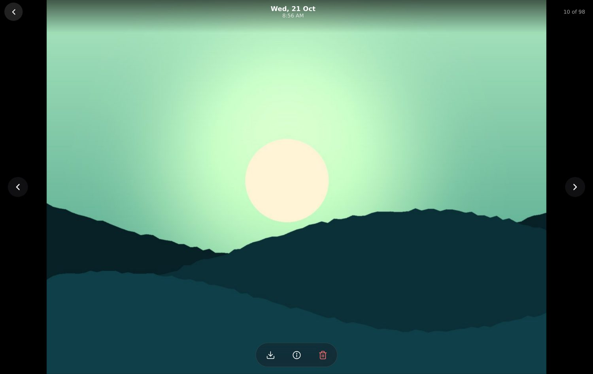
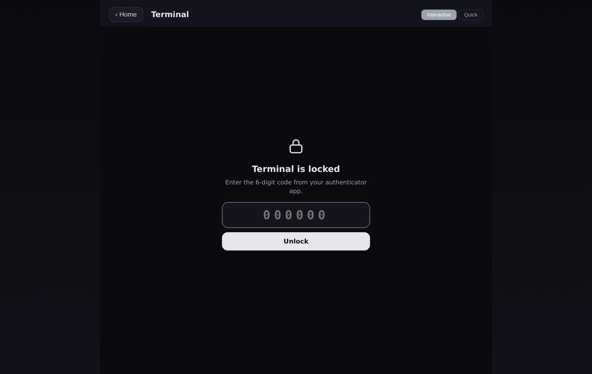

<div align="center">

# Project Recl/\mr

**Reclaim your data big tech is so hungry for, in a browser tab.**

A self-hosted web app (and installable PWA) that turns the computer under your desk into a photo library, file manager, music player, audiobook reader and control panel. Open it from your phone, laptop or TV. No accounts, no subscriptions, and your files never leave your machine.


</div>

---

## Contents

[Highlights](#highlights) · [Screenshots](#screenshots) · [Quick start](#quick-start) · [Remote access](#remote-access) · [Android apps](#android-apps) · [Phone backup](#phone-backup) · [Terminal two-step code](#terminal-two-step-code) · [Configuration](#configuration) · [Security](#security) · [Integrations](#integrations) · [Operating it](#operating-it) · [Development](#development) · [License](#license)

---

## Highlights

| | |
|---|---|
| 🖼️ **Gallery** | An iOS / Google Photos style library for your camera roll and screenshots, built for libraries of thousands of photos. |
| 📁 **Files** | A Finder / Nautilus style browser for one folder, or (opt-in) the whole machine. |
| 🎵 **Music** | A full player on top of Navidrome, with two themes and cross-device **Connect**. |
| 📚 **Audiobooks** | Read PDF, JSON and TXT books with real-time word highlighting and voice playback. |
| 🤖 **AI** | Local chat through Ollama, image generation through ComfyUI, a hardware-aware model advisor. |
| 🖥️ **Terminal** | A real PTY terminal in the browser, locked behind an authenticator-app code. |
| 📊 **Lab and Logs** | Live stats for every machine you own, plus an audit trail of sign-ins and deletions. |

Every app is optional. DeCloud works with zero configuration, and anything that needs an outside service degrades gracefully with a helpful message.

## Screenshots

<p align="center">
  
</p>

### Music: two themes

<table>
  <tr>
    <td width="50%"><br><sub><b>Spotify theme.</b> Library sidebar, playlist pages with a playing indicator, queue, lyrics and Connect.</sub></td>
    <td width="50%"><br><sub><b>Glossy Black theme.</b> A Mac-style glass player that tints itself from the cover.</sub></td>
  </tr>
</table>

<p align="center">
  
</p>

<table>
  <tr>
    <td width="50%"><br><sub><b>Viewer.</b> Swipe, pinch and double-tap zoom, drag down to close, video, details.</sub></td>
    <td width="50%"><br><sub><b>Files.</b> Icon view with live thumbnails, places sidebar, sortable list view.</sub></td>
  </tr>
  <tr>
    <td width="50%"><br><sub><b>Logs.</b> Every sign-in, failed attempt, terminal unlock and deletion, with IP and device.</sub></td>
    <td width="50%"><br><sub><b>Terminal.</b> Stays locked until you enter a code from your authenticator app.</sub></td>
  </tr>
</table>

## What is inside

### 🖼️ Gallery
- Library, Videos and Screenshots tabs, read straight from the `Camera` and `Screenshots` folders of your backup (for example an Android phone backup).
- Photos grouped by day with sticky headers, a **year and month scrubber** you can drag, and video length badges.
- Pinch (or Ctrl and scroll) to change the grid density. Long-press or **Select** to pick several, then download or move to Trash.
- Thumbnails respect the phone's rotation flag and are generated once and cached. Videos get a poster frame.
- The viewer streams originals with Range support, so long videos seek instantly. Zooming into a photo swaps in the full-resolution file.
- Back, forward and reload all land you on the same photo.

### 📁 Files
- Places sidebar, path bar, list and icon views, sortable columns, search, and full keyboard navigation (arrows, Enter, Backspace, Delete).
- Right-click or long-press menus: open, download, move to Trash, Poof, Shred.
- Opens in your home folder. Set `DECLOUD_BROWSE_ROOT=/` to browse the entire machine.
- Photos and videos open in the same viewer as the Gallery.
- **Swipe cleanup** lets you triage a folder Tinder-style: left for Trash, right for Poof.

### 🎵 Music
- Works with [Navidrome](https://www.navidrome.org) / any Subsonic server, with a built-in file-tag fallback.
- **Two themes:** a glossy black player, and a Spotify-style layout with home shelves, album and artist pages, a library sidebar, queue, and a draggable full-screen player on phones.
- **Connect:** see every signed-in device, pause on one and it pauses on all, hand playback to another device, and keep your place across refreshes and devices.
- Bass-reactive visualizer, haptics on mobile, media keys and lock-screen controls.
- An optional desktop companion (`static/tools/decloud-mpris.py`) adds shuffle and repeat to the KDE or GNOME media widget.

### 📚 Audiobooks and 🤖 AI
- Audiobooks: PDF, JSON and TXT, Piper TTS voices, bookmarks, chapter navigation, AI summaries.
- AI Chat through Ollama or a cloud API. Image generation through ComfyUI.
- **Model Advisor:** reads your hardware and scores models from HuggingFace using real file sizes, then downloads them into the right folders. Split GGUF files are merged and chat models are imported into Ollama for you.
- A voice assistant that can navigate the app and answer questions.

### 📊 Lab, Logs, Terminal
- **My Lab:** CPU, RAM, GPU, disk and network for this machine and any others you add (paired with a six-digit code, Bluetooth style).
- **Logs:** an append-only audit trail (`audit.log`, mode 0600, rotated at about 1 MB) with filters for sign-ins, terminal, files and alerts.
- **Terminal:** a full-screen xterm.js terminal, protected by [two-step codes](#terminal-two-step-code).

## Quick start

**Requirements:** Linux or macOS (Linux recommended for GPU features), Python 3.10+, and [Tailscale](https://tailscale.com) if you want remote access. Windows is supported for everything except the interactive terminal (see [Windows](#windows)).

```bash
git clone https://github.com/rxjdeep/decloud.git ~/decloud
cd ~/decloud
./install.sh
```

The installer creates a virtual environment, installs dependencies, writes a `.env` with a random secret key and a generated 8-digit passcode (change it any time in Settings or `.env`), sets up a systemd user service (auto-start on boot, auto-restart on crash), starts a Tailscale Funnel, and prints your URL with a QR code for your phone.

Already have a copy and just want to run it?

```bash
python3 -m venv .venv && .venv/bin/pip install -r requirements.txt
# set DECLOUD_PIN in .env first, otherwise there is no sign-in
.venv/bin/python app.py        # http://127.0.0.1:8899
```

## Remote access

DeCloud binds to **localhost only**. To reach it from your phone, put a tunnel in front of it. The supported way is [Tailscale Funnel](https://tailscale.com/kb/1223/funnel):

```bash
tailscale funnel 8899          # https://<machine>.<tailnet>.ts.net
```

- No port forwarding, works behind NAT and firewalls.
- End-to-end encrypted (WireGuard and TLS 1.3), with a permanent URL.
- Friends need no Tailscale account, they just open the link.
- `cloudflared` works too if you prefer it.

Open the URL, sign in with your password, and choose **Add to Home Screen** to install it as an app.

## Android apps

Two small native apps live in `android/` (plain Java, no libraries, built in a throwaway Docker container). They are separate: separate package names, installed and updated on their own, and neither touches the other.

- **DeCloud** (`android/shell`, about 30 KB): a WebView on your server, drawn edge to edge under transparent system bars. Lock-screen music controls keep playing with the screen off (a media service runs only while something plays); swiping the app from recents pauses the music and ends the app. It also handles downloads, uploads, the Voice microphone and long-press shortcuts. Build with `./scripts/build_android.sh shell`, install with `./scripts/install_app.sh`.
- **DeCloud Backup** (`android/pusher`, about 30 KB): pushes new photos, screenshots, downloads and documents to the server, described next. Build with `./scripts/build_android.sh pusher`, install with `./scripts/install_pusher.sh`.

## Phone backup

DeCloud Backup runs through Android's own `JobScheduler`: the system wakes it shortly after new media appears, with the battery not low, and the schedule survives reboots. There is no daemon, no polling and nothing to restart. Between runs the app does not exist as a process. On mobile data it sends files up to a size limit (25 MB by default) and asks through a notification before sending larger ones.

The server side is off until you set a token (`routes/backup.py`). The phone's token is separate from your login and can only add files: it cannot list, read, overwrite or delete anything.

```bash
# .env
DECLOUD_BACKUP_TOKEN=<24+ random characters>     # python3 -c "import secrets; print(secrets.token_urlsafe(36))"
DECLOUD_BACKUP_URL=https://your-box.example.ts.net
DECLOUD_BACKUP_DIR=/path/to/backups              # Camera/, Screenshots/, Downloads/, Documents/ are created inside

./scripts/build_android.sh pusher    # builds the APK in a throwaway Docker container; nothing is installed on the server
./scripts/install_pusher.sh    # installs it through a shell you already have on the phone (pm install + appops)
```

Files are stored as they arrive (never overwritten, written as `.part` then renamed, the phone's modified time kept). The APK has the URL and token compiled in, so keep it private; rotate the token by rebuilding and running the installer again.

## Terminal two-step code

The web terminal is a shell on your machine, so it asks for a second factor even after you have signed in. Set it up **once, in your own terminal on the server** (never through the web UI, so an attacker who reaches the homepage cannot enrol their own device):

```bash
.venv/bin/python scripts/totp_setup.py
```

It prints a QR code (needs `qrencode`) and a secret. Add it to any authenticator app (Aegis, 2FAS, Google Authenticator: TOTP, SHA1, 6 digits, 30 s). Until you do, the Terminal stays locked and tells you how to fix that.

- A correct code unlocks the terminal for 4 hours for that session.
- Five wrong codes lock it for 15 minutes. A code can be used only once.
- Test a code without the browser: `.venv/bin/python scripts/totp_setup.py --check 123456`.
- Replace the secret with `--reset`.

## Configuration

Everything is configured through environment variables in `.env` (see [`.env.example`](.env.example)). Restart after editing.

| Variable | Default | Description |
|---|---|---|
| `DECLOUD_PORT` | `8899` | Port to listen on |
| `DECLOUD_HOST` | `127.0.0.1` | Bind address. Leave it on loopback and use a tunnel |
| `DECLOUD_PIN` | *(generated by the installer)* | Your sign-in password (8 to 64 characters). Leave it unset only for local experiments, because then there is no sign-in |
| `DECLOUD_FILES_DIR` | `~` | Base folder for Files, and the folder that contains `Camera` and `Screenshots` for the Gallery |
| `DECLOUD_BROWSE_ROOT` | *(= `DECLOUD_FILES_DIR`)* | Set to `/` to let Files browse the whole machine |
| `DECLOUD_BOOKS_DIR` | `~/Books` | Audiobook library |
| `DECLOUD_MUSIC_DIR` | `~/Music` | Music folder (file-tag fallback) |
| `DECLOUD_NAVIDROME_URL` | `http://127.0.0.1:4533/navidrome` | Navidrome / Subsonic server |
| `DECLOUD_NAVIDROME_USER`, `DECLOUD_NAVIDROME_PASS` | | Navidrome credentials (used server-side only) |
| `OLLAMA_HOST` | `http://localhost:11434` | Ollama endpoint |
| `DECLOUD_LLM_MODEL` | `llama3.2` | Default chat model |
| `COMFY_URL` | `http://localhost:8188` | ComfyUI endpoint |
| `DECLOUD_PIPER_DIR` | `~/.local/share/piper` | Piper voice models |
| `DECLOUD_MODELS_DIR`, `DECLOUD_COMFY_MODELS_DIR` | `~/Models`, `~/ComfyUI/models` | Where the Model Advisor downloads to |
| `DECLOUD_TOTP_FILE`, `DECLOUD_AUDIT_FILE` | `totp.json`, `audit.log` | Locations of the terminal secret and audit trail |
| `DECLOUD_UPDATE_REPO` | `rxjdeep/decloud` | GitHub repo the self-updater checks |

Optional integrations: `DECLOUD_OSINT_DIR` (privacy scanner), `DECLOUD_JOURNAL_DIR` (Obsidian vault with voice notes), `DECLOUD_HERMES_HOME` (agents panel).

## Security

DeCloud is designed to be exposed to the internet through a tunnel, so the defaults are strict.

- **Authentication:** password login. The password is used once; afterwards the app uses an opaque session token (HttpOnly, SameSite=Strict, 30-day expiry), never the password. Logins are throttled with exponential backoff.
- **Second factor for the shell:** TOTP with replay protection and lockout (see above). The terminal socket refuses connections without it.
- **CSRF protection:** every state-changing request needs a per-session token.
- **Strict Content-Security-Policy:** no third-party scripts (every library is vendored under `static/vendor`), no inline `<script>` blocks, no `javascript:` URLs. All user-supplied strings are escaped before they reach the page, and inline handlers receive values through a JSON-safe helper.
- **Path safety:** every filesystem path from the browser is resolved and checked against the configured root; symlink and traversal attempts are rejected. Media endpoints serve only image and video files.
- **Least privilege:** runs as your normal user, binds to localhost, and the systemd unit the installer writes sets `NoNewPrivileges`, `RestrictSUIDSGID`, `LockPersonality`, `RestrictRealtime`, a memory ceiling and a task limit.
- **Audit trail:** sign-ins, failures, terminal unlocks and denials, and file deletions are logged with IP and device. Passwords and codes are never written down.
- **No telemetry.** Usage stats stay in a local JSON file.

Please report vulnerabilities privately (GitHub Security tab) rather than in a public issue. See also [SECURITY_AUDIT.md](SECURITY_AUDIT.md) for the audit and its accepted limitations.

> **Note:** `NoNewPrivileges` also stops `sudo` inside the web terminal. Use SSH for administration. Remove that line from the unit file if you disagree.

## Integrations

<details>
<summary><b>Navidrome (Music)</b></summary>

Install [Navidrome](https://www.navidrome.org), point it at your music, then add to `.env`:

```env
DECLOUD_NAVIDROME_URL=http://127.0.0.1:4533/navidrome
DECLOUD_NAVIDROME_USER=you
DECLOUD_NAVIDROME_PASS=your-navidrome-password
```

DeCloud proxies streams, artwork, stars and scrobbles server-side, so your Navidrome credentials never reach the browser.

For shuffle and repeat in the KDE or GNOME media widget, run the companion on your desktop:

```bash
curl -O https://<your-decloud>/static/tools/decloud-mpris.py
python3 decloud-mpris.py --install-service
```
</details>

<details>
<summary><b>Ollama (AI Chat) and the Model Advisor</b></summary>

```bash
# https://ollama.com
ollama pull llama3.2
```

Open **My Lab** to see which models fit your machine. **Get** downloads them to the right place, and chat models are imported into Ollama automatically.

```env
DECLOUD_MODELS_DIR=~/Models
DECLOUD_COMFY_MODELS_DIR=~/ComfyUI/models
```
</details>

<details>
<summary><b>ComfyUI (images) and Piper (audiobook voices)</b></summary>

```bash
# ComfyUI: https://github.com/comfyanonymous/ComfyUI  (start it, then set COMFY_URL)
# Piper:   pip install piper-tts  and put voices in ~/.local/share/piper/
```
</details>

## Operating it

```bash
./decloud start | stop | restart | status | qr | version
systemctl --user status decloud       # service state
systemctl --user restart decloud      # after editing .env
journalctl --user -u decloud -f       # live logs
```

**Updates:** Settings > About > *Check for updates*. The updater shows the exact version and asks first, refuses to touch a tree with local edits, test-boots the new version on a scratch port before restarting, rolls back automatically on failure, and offers a one-click revert. `.env`, your books and settings are never touched.

### Windows

```powershell
powershell -ExecutionPolicy Bypass -File .\setup.ps1
.\decloud.ps1 status
```

Everything works except the interactive terminal, which needs a POSIX PTY.

## Development

```bash
pip install -r requirements-dev.txt
python -m pytest -q          # 138 tests: auth, path security, terminal allowlist, TOTP, gallery, updater
```

Project layout:

```
app.py                 entry point
shared.py              config, sessions, security headers, helpers
audit.py               append-only audit trail
routes/                Flask blueprints, one per feature
  gallery.py           media list, thumbnails, posters, inline file serving
  lego.py              Files browser and file actions
  security.py          terminal TOTP and the logs API
  music.py             Navidrome proxy and the Connect WebSocket
  terminal.py          PTY terminal over WebSocket
templates/index.html   single-page app shell
static/
  js/modules/          one module per app (gallery.js, lego.js, music.js, nav.js, ...)
  css/                 app.css, gallery.css, onboarding.css
  vendor/              xterm, three, qrcode, cannon-es, fonts (served locally)
  tools/               desktop media-widget companion
scripts/               TOTP setup, version bump, updater
tests/                 pytest suite
```

Adding an app: create `routes/myapp.py` with a Blueprint and register it in `routes/__init__.py`, add `static/js/modules/myapp.js`, list it in `APPS` in `core.js`, and bump the cache version in `static/sw.js`. See [`AGENTS.md`](AGENTS.md) and [`CONTRIBUTING.md`](CONTRIBUTING.md) for conventions.

## License

[MIT](LICENSE). Use it, change it, host it for your family.
