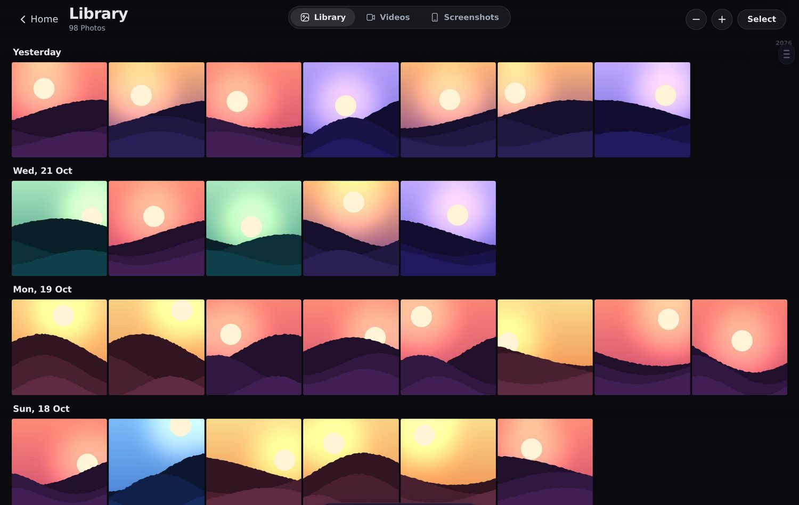
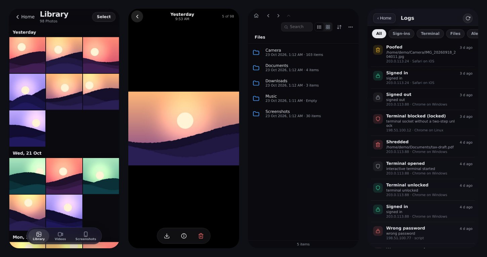
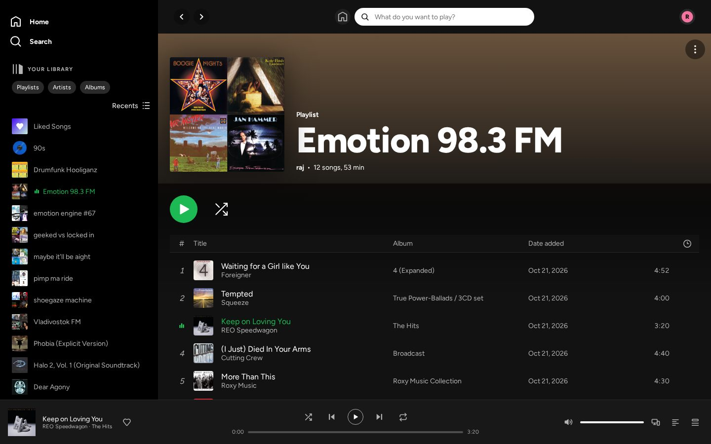
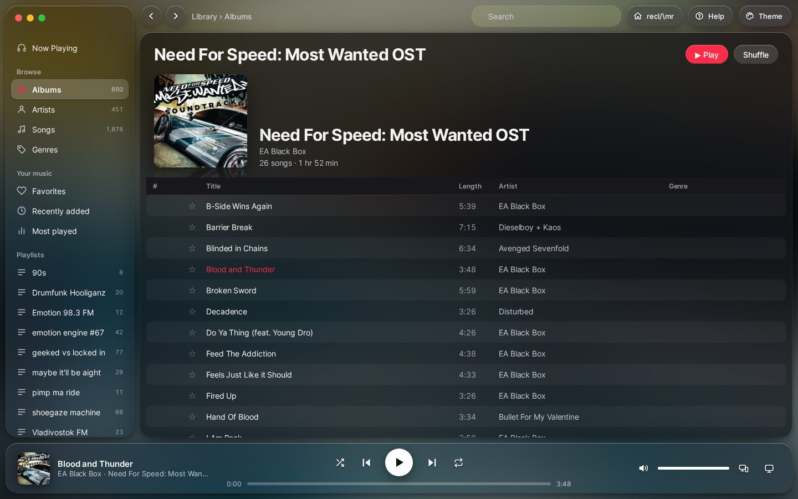
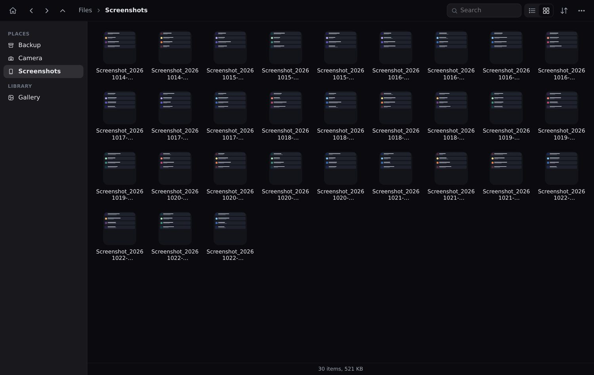
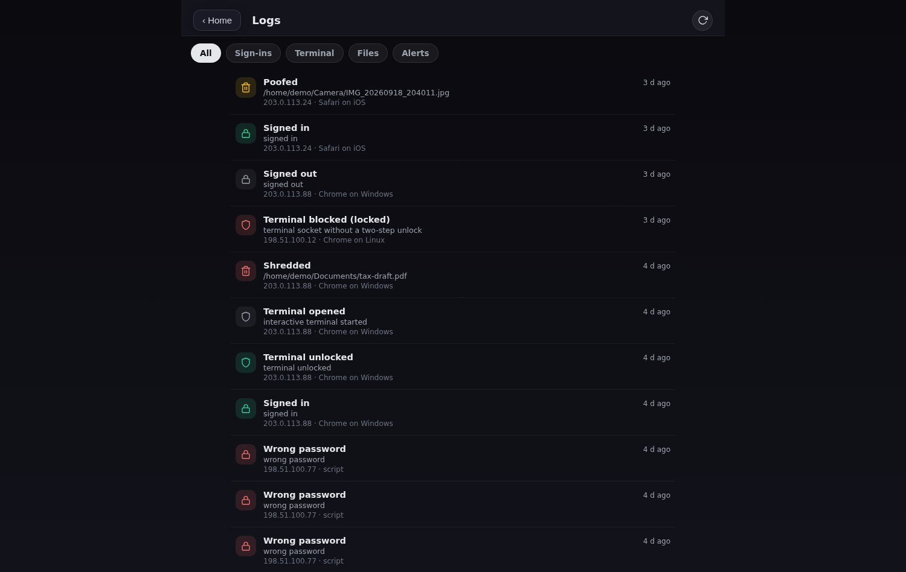
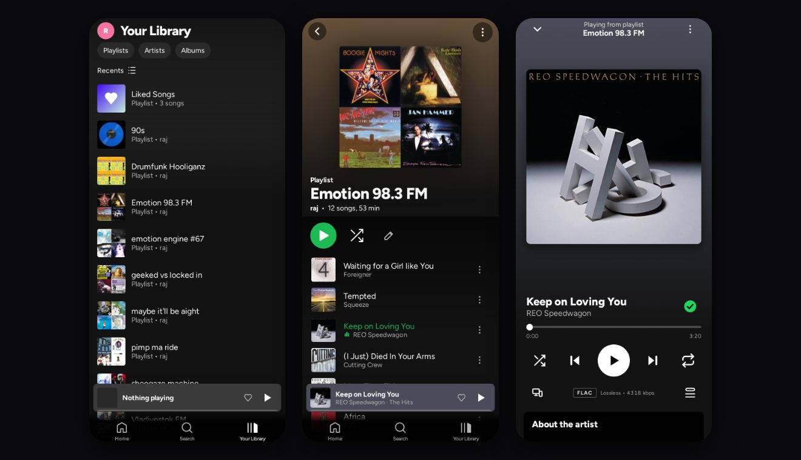

<div align="center">

# Project Recl/\mr

**Reclaim your data big tech is so hungry for, in a browser tab.**

A self-hosted web app (and installable PWA) that turns the computer under your desk into a photo library, file manager, music player, audiobook reader and control panel. Open it from your phone or laptop. No accounts, no subscriptions, and your files stay on your machine.




</div>

---

## What it does

Every app is optional. reclmr runs with no configuration, and anything that needs an outside service tells you what is missing.

- **Gallery:** your camera roll and screenshots by day, with a year and month scrubber, pinch to resize the grid, multi-select, and a full-screen viewer that streams originals.
- **Files:** a Finder-style browser with places, list and icon views, search, upload (button or drag and drop), a Trash you can empty, and a swipe mode for sorting a folder quickly.
- **Music:** a player on top of [Navidrome](https://www.navidrome.org) (any Subsonic server) with a file-tag fallback. See below.
- **Audiobooks:** PDF, JSON and TXT books with Piper voices, bookmarks, chapters, a page-image view for PDFs, and AI summaries.
- **AI:** chat through Ollama, image generation through ComfyUI, a voice assistant, and a Model Advisor that scores models for your hardware and downloads them.
- **Terminal:** a PTY terminal in the browser, locked behind an authenticator-app code.
- **My Lab and Logs:** live stats for this machine and others you pair (with a six-digit code), and an audit trail of sign-ins, terminal unlocks and deletions.

### Music

- **Two themes:** Glossy Black (a glass, Mac-style player) and Spotify, with home shelves, album and artist pages, a queue and a full-screen player on phones.
- **Playlists:** create, rename and delete (with undo), drag to reorder, select several songs to move or remove together, and a tick on songs already in a playlist.
- **Lyrics:** synced lines from your tags or LRCLIB, shown live on the player.
- **Streaming quality:** choose Original or a lower MP3 rate separately for Wi-Fi and mobile data. Converted files are cached on the server.
- **Artist photos and banners**, a playing indicator wherever the current album or playlist is listed, a bass-reactive visualizer, and media keys.
- **Connect:** see every signed-in device, hand playback to another one, and keep your place across devices.

## Screenshots

<p align="center">
  
</p>

<table>
  <tr>
    <td width="50%"><br><sub><b>Music, Spotify theme.</b></sub></td>
    <td width="50%"><br><sub><b>Music, Glossy Black theme.</b></sub></td>
  </tr>
  <tr>
    <td width="50%"><br><sub><b>Files.</b> Icon view with thumbnails and a places sidebar.</sub></td>
    <td width="50%"><br><sub><b>Logs.</b> Sign-ins, failed attempts and deletions, with IP and device.</sub></td>
  </tr>
</table>

<p align="center">
  
</p>

## Quick start

**Requirements:** Linux or macOS, Python 3.10+, and [Tailscale](https://tailscale.com) for remote access. Windows is experimental and untested (see [Windows](#windows)).

```bash
git clone https://github.com/rxjdeep/decloud.git ~/reclmr
cd ~/reclmr
./install.sh
```

The installer creates a virtual environment, installs dependencies, writes a `.env` with a random secret key and a generated 8-digit passcode, sets up a systemd user service (starts on boot, restarts on a crash), starts a Tailscale Funnel, and prints your address.

Just want to run it from a copy?

```bash
python3 -m venv .venv && .venv/bin/pip install -r requirements.txt
# set RECLMR_PIN in .env first, otherwise there is no sign-in
.venv/bin/python app.py        # http://127.0.0.1:8899
```

## Remote access

reclmr listens on **localhost only**. To reach it from your phone, put a tunnel in front of it. The supported way is [Tailscale Funnel](https://tailscale.com/kb/1223/funnel):

```bash
tailscale funnel 8899          # https://<machine>.<tailnet>.ts.net
```

Open that address, sign in, and choose **Add to Home Screen**. `cloudflared` also works. There is no port forwarding to set up. The first-run walkthrough shows a QR code for the address you opened it from; if you opened it on localhost, it asks you to paste your tunnel address instead.

## Android apps

Two small apps in `android/` (plain Java, no libraries, built in a throwaway Docker container). They are separate apps with separate package names.

- **reclmr** (`android/shell`): a WebView on your server, drawn edge to edge. It adds lock-screen music controls (play, skip, shuffle, repeat, seek) that keep playing with the screen off, keeps the screen on while Now Playing is open, turns off the system's left-edge back swipe while it is open (so the page's own edge swipe works), and adds long-press shortcuts and sharing text into Search. Build with `./scripts/build_android.sh shell`, install with `./scripts/install_app.sh`.
- **reclmr Backup** (`android/pusher`): sends new photos, screenshots, downloads and documents to the server. Build with `./scripts/build_android.sh pusher`, install with `./scripts/install_pusher.sh`.

Both install scripts talk to a shell you already have on the phone (an adb-style sshd, or `adb shell`). Put its address in `.env` as `RECLMR_PHONE=shell@<phone address>`, or pass `PHONE=...`.

### Phone backup

Backup runs through Android's own `JobScheduler`: the system wakes it shortly after new media appears, and the schedule survives reboots. There is no daemon. Uploads resume if the connection drops. You can limit it to Wi-Fi, pause or skip a file from its notification, and on mobile data it sends files up to a size limit (25 MB by default) before asking about larger ones.

The server side is off until you set a token. The phone's token is separate from your login and can only add files: it cannot list, read, overwrite or delete anything.

```bash
# .env
RECLMR_BACKUP_TOKEN=<24+ random characters>     # python3 -c "import secrets; print(secrets.token_urlsafe(36))"
RECLMR_BACKUP_URL=https://your-box.example.ts.net
RECLMR_BACKUP_DIR=/path/to/backups              # Camera/, Screenshots/, Downloads/, Documents/ are created inside
```

Files are never overwritten and are written as `.part` then renamed. The APK has the address and token compiled in, so keep it private; rotate the token by rebuilding and installing again.

## Terminal two-step code

The web terminal is a shell on your machine, so it asks for an authenticator code even after you sign in. Set it up **once, in a terminal on the server**, never through the web page:

```bash
.venv/bin/python scripts/totp_setup.py
```

It prints a QR code (needs `qrencode`) and a secret for any authenticator app (TOTP, SHA1, 6 digits, 30 s). Until you do this the Terminal stays locked.

- A correct code unlocks it for 4 hours for that session, and each code works once.
- Five wrong codes lock it for 15 minutes.
- Check a code without the browser: `.venv/bin/python scripts/totp_setup.py --check 123456`. Replace the secret with `--reset`.

## Configuration

Settings are environment variables in `.env` (see [`.env.example`](.env.example)). Restart after editing.

| Variable | Default | Description |
|---|---|---|
| `RECLMR_PORT` | `8899` | Port to listen on |
| `RECLMR_HOST` | `127.0.0.1` | Bind address. Leave it on loopback and use a tunnel |
| `RECLMR_PIN` | *(generated by the installer)* | Sign-in passcode, 8 to 64 characters. If unset there is no sign-in |
| `RECLMR_FILES_DIR` | `~` | Base folder for Files, and the folder holding `Camera` and `Screenshots` for the Gallery |
| `RECLMR_BROWSE_ROOT` | *(= `RECLMR_FILES_DIR`)* | Set to `/` to let Files browse the whole machine |
| `RECLMR_BOOKS_DIR` | `~/Books` | Audiobook library |
| `RECLMR_MUSIC_DIR` | `~/Music` | Music folder (file-tag fallback) |
| `RECLMR_NAVIDROME_URL` | `http://127.0.0.1:4533/navidrome` | Navidrome / Subsonic server |
| `RECLMR_NAVIDROME_USER`, `RECLMR_NAVIDROME_PASS` | | Navidrome credentials, used on the server only |
| `OLLAMA_HOST` | `http://localhost:11434` | Ollama endpoint |
| `RECLMR_LLM_MODEL` | `llama3.2` | Default chat model |
| `COMFY_URL` | `http://localhost:8188` | ComfyUI endpoint |
| `RECLMR_PIPER_DIR` | `~/.local/share/piper` | Piper voice models |
| `RECLMR_MODELS_DIR`, `RECLMR_COMFY_MODELS_DIR` | `~/Models`, `~/ComfyUI/models` | Where the Model Advisor downloads to |
| `RECLMR_TOTP_FILE`, `RECLMR_AUDIT_FILE` | `totp.json`, `audit.log` | Terminal secret and audit trail |
| `RECLMR_TRANSCODE_CACHE_MB` | `2048` | Size limit for the converted-music cache |
| `RECLMR_UPDATE_REPO` | `rxjdeep/decloud` | GitHub repo the updater checks |

The older `DECLOUD_*` names keep working. If both spellings of one setting are in the same `.env`, the `DECLOUD_` one is used, so pick one prefix.

Optional: `RECLMR_OSINT_DIR` (privacy scanner), `RECLMR_JOURNAL_DIR` (Obsidian vault for voice notes), `RECLMR_HERMES_HOME` (agents panel).

**Navidrome:** install it, point it at your music, then set the three `RECLMR_NAVIDROME_*` values. reclmr proxies streams, artwork, stars and scrobbles on the server, so the credentials never reach the browser.

**Ollama and ComfyUI:** install them, then open **My Lab**. The Model Advisor lists what fits your hardware and downloads it to the right place; chat models are imported into Ollama automatically. Piper voices (`pip install piper-tts`) go in `~/.local/share/piper/`.

**Desktop media widget:** for shuffle and repeat in the KDE or GNOME media widget, run the companion on your desktop:

```bash
curl -O https://<your-reclmr>/static/tools/decloud-mpris.py
python3 decloud-mpris.py --install-service
```

## Security

reclmr is meant to be reached through a tunnel, so the defaults are strict.

- **Sign-in:** a passcode, used once. After that the app uses an opaque session token (HttpOnly, SameSite=Strict, 30 days), never the passcode. Failed logins back off exponentially.
- **Terminal:** a second factor with replay protection and lockout (above). The terminal socket refuses connections without it.
- **CSRF:** state-changing requests need a per-session token.
- **Content-Security-Policy:** no third-party scripts (libraries are vendored under `static/vendor`), no inline `<script>` blocks, no `javascript:` URLs.
- **Path safety:** every path from the browser is resolved and checked against the configured root. Symlink and traversal attempts are rejected.
- **Least privilege:** runs as your user and binds to localhost. The systemd unit the installer writes sets `NoNewPrivileges`, `RestrictSUIDSGID`, `LockPersonality`, `RestrictRealtime`, a memory ceiling and a task limit. `NoNewPrivileges` also stops `sudo` inside the web terminal; use SSH for administration, or remove that line.
- **Audit trail:** sign-ins, failures, terminal unlocks and denials, and file deletions are logged with IP and device (`audit.log`, mode 0600, rotated at about 1 MB). Passcodes are never written down.
- **No telemetry.** Usage stats stay in a local JSON file.

Report vulnerabilities privately (GitHub Security tab). See [SECURITY_AUDIT.md](SECURITY_AUDIT.md) for the audit and its accepted limitations.

## Operating it

```bash
./reclmr start | stop | restart | status | qr | version
systemctl --user status reclmr       # service state
systemctl --user restart reclmr      # after editing .env
journalctl --user -u reclmr -f       # live logs
```

(Installs made before the rename keep their `decloud` service name, and `./decloud` still works.)

**Updates:** Settings > About > *Check for updates*. The updater shows the version and asks first, refuses to touch a tree with local edits, test-boots the new version on a scratch port, rolls back on failure, and offers a one-click revert. `.env`, your books and settings are never touched.

### Windows

Experimental and untested. Everything except the interactive terminal (which needs a POSIX PTY) is meant to work:

```powershell
powershell -ExecutionPolicy Bypass -File .\setup.ps1
.\decloud.ps1 status
```

**Set `RECLMR_PIN` in `.env` yourself before exposing it.** The setup script is not verified to set a passcode, and without one the app has no sign-in.

## Development

```bash
pip install -r requirements-dev.txt
python -m pytest -q
```

```
app.py                 entry point
shared.py              config, sessions, security headers, helpers
audit.py               append-only audit trail
routes/                Flask blueprints, one per feature
templates/index.html   single-page app shell
static/js/modules/     one module per app (gallery.js, lego.js, music.js, ...)
static/css/            app.css, gallery.css, onboarding.css
static/vendor/         xterm, three, qrcode, cannon-es, fonts (served locally)
android/               the two Android apps
scripts/               TOTP setup, version bump, updater, Android build and install
tests/                 pytest suite
```

Adding an app: create `routes/myapp.py` with a Blueprint and register it in `routes/__init__.py`, add `static/js/modules/myapp.js`, list it in `APPS` in `core.js`, and bump the cache version in `static/sw.js`. See [`AGENTS.md`](AGENTS.md) and [`CONTRIBUTING.md`](CONTRIBUTING.md).

## License

[MIT](LICENSE). Use it, change it, host it for your family.
